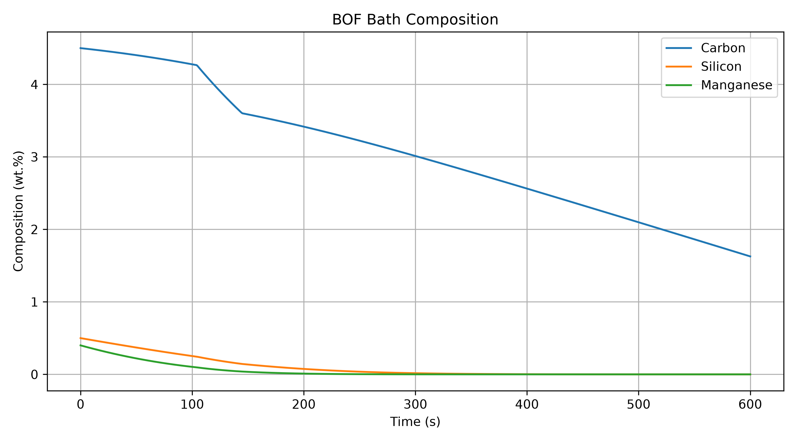
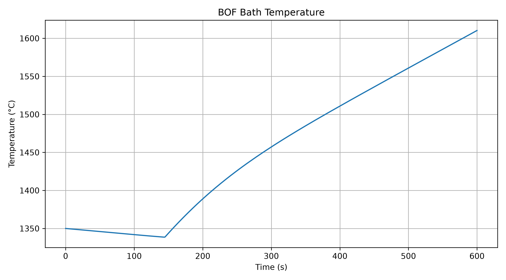
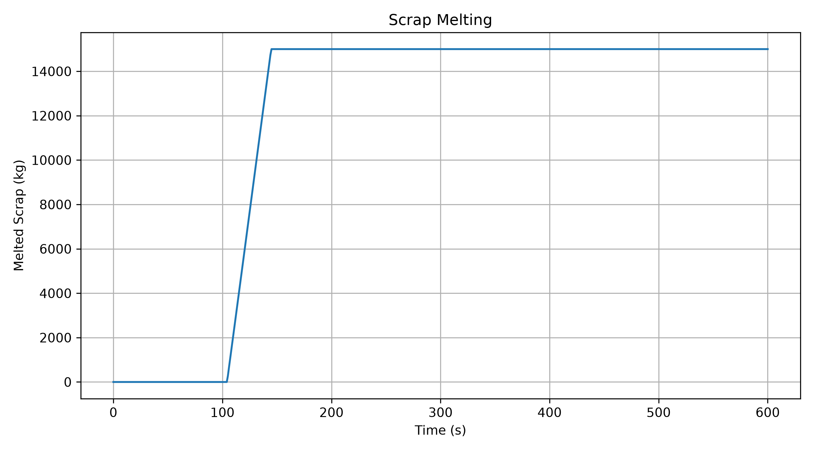
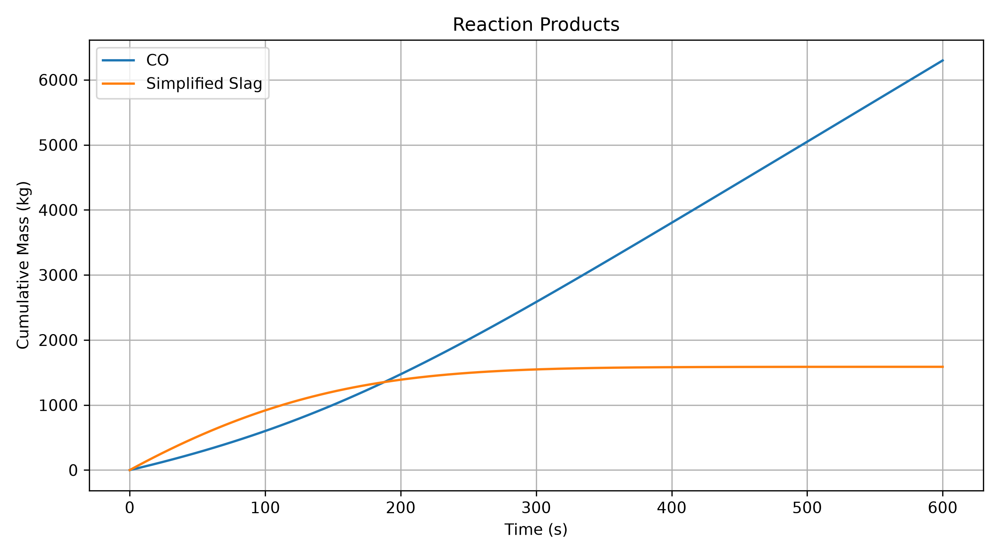
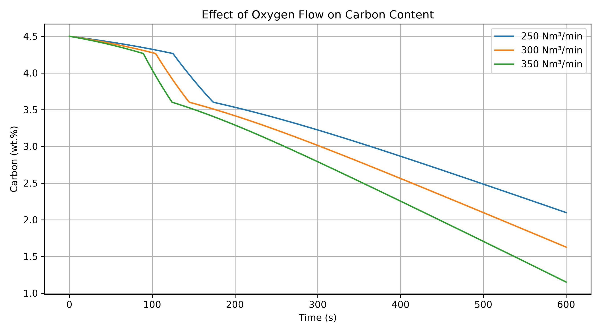
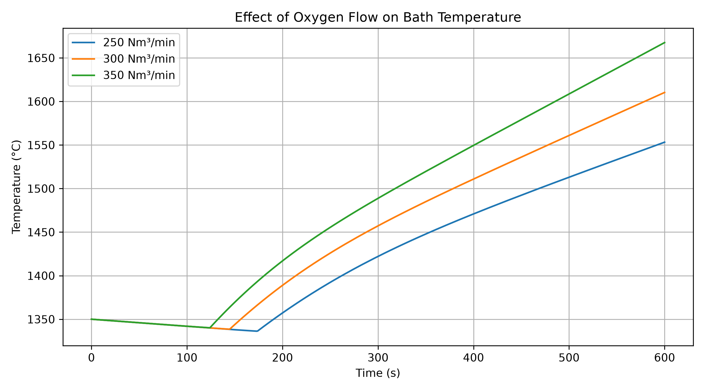
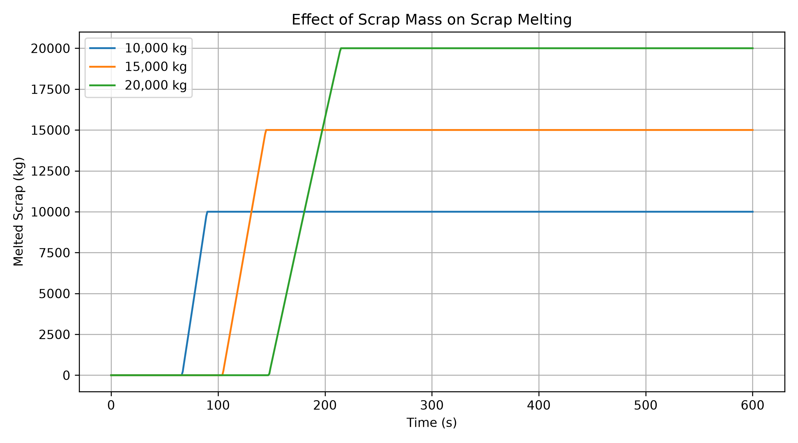

# BOF Dynamic Process Model

A simplified physics-based dynamic simulation of the **Basic Oxygen Furnace (BOF) steelmaking process**, developed in C++ and extended with machine learning and a desktop engineering interface.

The project was developed to apply undergraduate metallurgy, thermodynamics, mass/energy balance, and programming knowledge to a process-modeling problem relevant to steelmaking.

## Project Overview

The model simulates the evolution of a BOF heat from an initial hot-metal and scrap charge to a specified carbon endpoint.

The project consists of three main layers:

**C++ Physics Model → Machine Learning Surrogate → Desktop Application**

The C++ model calculates the process dynamically, Python is used for data analysis and machine learning, and a PySide6 desktop application provides an engineering interface for running and comparing simulations.

> **Scope:** This is an educational engineering model. It is not intended to reproduce an industrial BOF Level-2 model or digital twin.

---

## Main Features

### C++ Process Model

The dynamic process model includes:

- Carbon oxidation
- Silicon oxidation
- Manganese oxidation
- Oxygen allocation between reactions
- Low-carbon / late-blow correction
- Dynamic mass balance
- Reaction heat generation
- Heat losses to the surroundings
- Gas sensible heat
- Simplified slag sensible heat
- Scrap heating and melting
- Dynamic bath temperature
- CO production
- Simplified slag formation
- Carbon endpoint detection
- CSV process-history output

The principal simplified reactions are:

```text
C  + 1/2 O₂ → CO
Si + O₂     → SiO₂
Mn + 1/2 O₂ → MnO
```

---

## Model Architecture

```text
Process Inputs
      │
      ▼
┌─────────────────────┐
│   C++ BOF Model     │
│                     │
│ Reaction Model      │
│ Material Balance    │
│ Energy Balance      │
│ Scrap Model         │
└──────────┬──────────┘
           │
           ▼
   Dynamic Process Data
           │
      ┌────┴─────┐
      ▼          ▼
 CSV Results   ML Dataset
                  │
                  ▼
          ML Surrogate Models
                  │
                  ▼
          Desktop Application
```

---

## Baseline Simulation

A representative baseline simulation uses:

| Parameter | Value |
|---|---:|
| Hot metal | 100,000 kg |
| Scrap | 15,000 kg |
| Initial bath temperature | 1350 °C |
| Initial carbon | 4.5 wt.% |
| Initial silicon | 0.5 wt.% |
| Initial manganese | 0.4 wt.% |
| Oxygen flow | 300 Nm³/min |
| Target carbon | 0.06 wt.% |

The baseline model reaches the carbon endpoint at approximately:

| Result | Value |
|---|---:|
| Endpoint time | 996 s |
| Endpoint temperature | 1635.6 °C |
| Final carbon | 0.0599 wt.% |
| Melted scrap | 15,000 kg |
| CO produced | 10,375 kg |
| Simplified slag | 1,588 kg |

The reported mass- and energy-balance closure errors are numerical bookkeeping checks and should not be interpreted as experimental validation.

---

## Process Results

### Composition Evolution



### Bath Temperature



### Scrap Melting



### Product Formation



---

## Parameter Studies

The model can be used to investigate the effect of operating parameters on the simulated process.

Examples include variations in:

- Oxygen flow rate
- Scrap mass
- Initial bath temperature

### Oxygen Flow and Carbon Evolution



### Oxygen Flow and Temperature



### Scrap Melting Comparison



These studies are intended for engineering sensitivity analysis within the assumptions of the simplified model.

---

## Machine Learning Surrogate

A dataset of **1,000 simulations** was generated directly from the C++ process model.

The ML layer therefore acts as a **surrogate model of the physics simulator** rather than a model trained on industrial plant data.

### Input Features

- Hot metal mass
- Scrap mass
- Initial temperature
- Initial carbon content
- Initial silicon content
- Initial manganese content
- Oxygen flow rate

### Prediction Targets

- Endpoint time
- Endpoint temperature

Two regression approaches were evaluated:

- Linear Regression
- Random Forest Regression

An 80/20 train-test split and 5-fold cross-validation were used.

### Final Model Performance

| Target | Model | MAE | RMSE | R² | 5-fold CV R² |
|---|---|---:|---:|---:|---:|
| Endpoint time | Linear Regression | 9.73 s | 12.74 s | 0.9894 | 0.9910 |
| Endpoint time | Random Forest | 17.15 s | 21.79 s | 0.9691 | 0.9633 |
| Endpoint temperature | Linear Regression | 2.15 °C | 2.92 °C | 0.9983 | 0.9982 |
| Endpoint temperature | Random Forest | 14.69 °C | 18.85 °C | 0.9298 | 0.9122 |

Linear Regression was selected as the final surrogate for both prediction targets.

The high agreement indicates that the surrogate reproduces the behavior of the implemented simulator over the generated parameter space. It does **not** represent accuracy against industrial BOF measurements.

---

## Desktop Application

A desktop engineering interface was developed using:

- PySide6
- PyQtGraph
- pandas
- scikit-learn / joblib

The application communicates directly with the compiled C++ process model and displays:

- Process input parameters
- C++ physics-model predictions
- ML surrogate predictions
- Physics-vs-ML differences
- Composition evolution
- Bath-temperature evolution
- Scrap melting
- CO and slag formation
- Full process-history table

The application can also be packaged as a standalone macOS `.app`.

---

## Project Structure

```text
bof-process-model/
│
├── include/                 C++ headers
├── src/                     C++ implementation
├── gui/
│   └── app.py               Desktop application
│
├── ml/
│   ├── train_model.py
│   ├── analyze_model.py
│   └── models/              Trained surrogate models
│
├── data/
│   └── ml_dataset.csv       Generated simulation dataset
│
├── results/                 Selected simulation plots
│
├── plot_results.py
├── plot_oxygen_scenarios.py
├── plot_all_scenarios.py
├── CMakeLists.txt
└── README.md
```

---

## Build

The C++ model requires a C++17-compatible compiler and CMake.

```bash
mkdir -p build
cd build
cmake ..
cmake --build .
```

---

## Running the C++ Model

Dataset-generation mode:

```bash
./build/bof_model --dataset 1000
```

Single-simulation mode:

```bash
./build/bof_model --simulate \
100000 15000 1350 4.5 0.5 0.4 300 0.06 results/simulation.csv
```

---

## Running the Desktop Application

Python dependencies include PySide6, PyQtGraph, pandas, joblib and scikit-learn.

From the project root:

```bash
python3 gui/app.py
```

The GUI invokes the compiled C++ executable and uses the trained surrogate models for comparison.

---

## Engineering Assumptions and Limitations

This project intentionally uses a simplified scope suitable for an undergraduate engineering project.

Important limitations include:

- Simplified reaction kinetics
- Simplified oxygen-allocation logic
- Simplified slag representation
- No detailed Fe/FeO oxidation model
- No phosphorus-removal model
- No detailed CO/CO₂ post-combustion model
- Simplified heat-loss representation
- Assumed gas and slag thermal properties
- No detailed refractory heat-transfer model
- No plant-data calibration
- No industrial Level-2 control logic

Some coefficients are engineering calibration parameters used to obtain physically plausible dynamic behavior and should not be interpreted as universal BOF constants.

The temperature prediction should be interpreted as an uncalibrated engineering estimate.

---

## Plausibility Check

The model was developed using mass conservation, energy conservation, reaction stoichiometry, thermodynamic data, and literature-informed BOF behavior.

Simulation trends and endpoint behavior are used as **engineering plausibility checks**, rather than claims of industrial validation.

Future work with access to suitable plant or experimental data could include parameter calibration and quantitative validation.

---

## Technologies

**C++17 · CMake · Python · pandas · scikit-learn · PySide6 · PyQtGraph · Machine Learning · Process Modeling · Metallurgy**

---

## Author

**Ayse Tugce Aydin**  
Materials Science and Technologies  
Turkish-German University